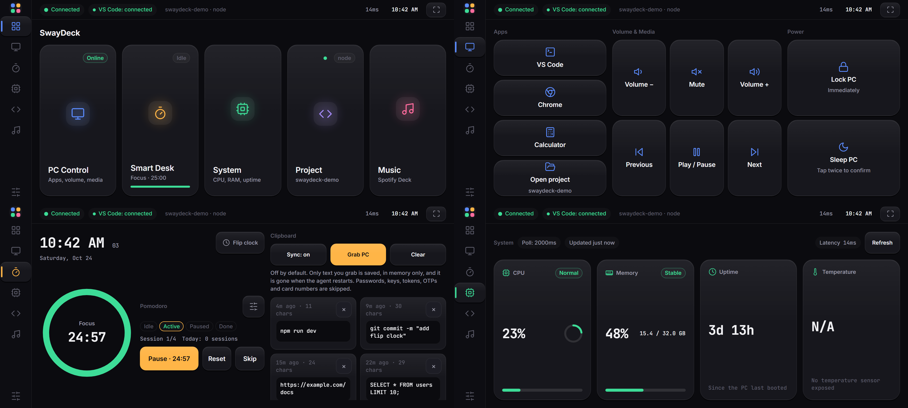
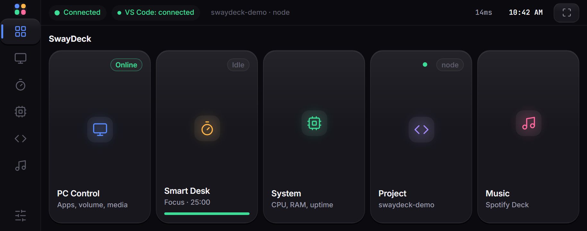
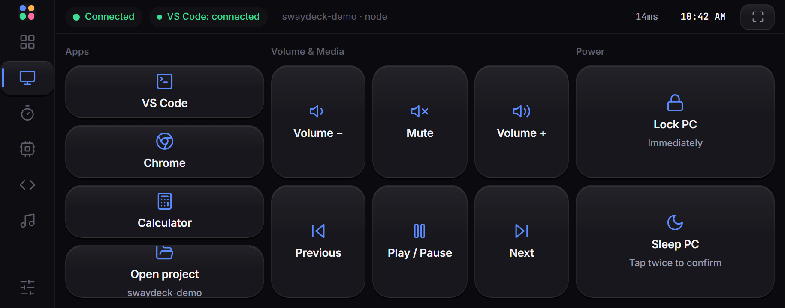
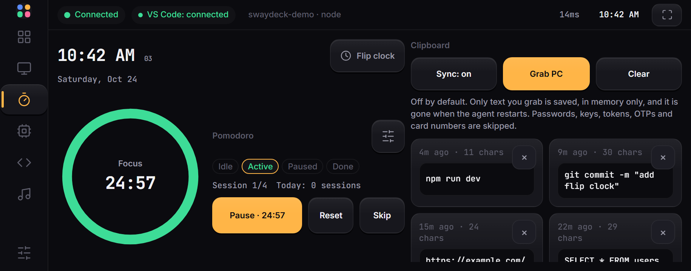
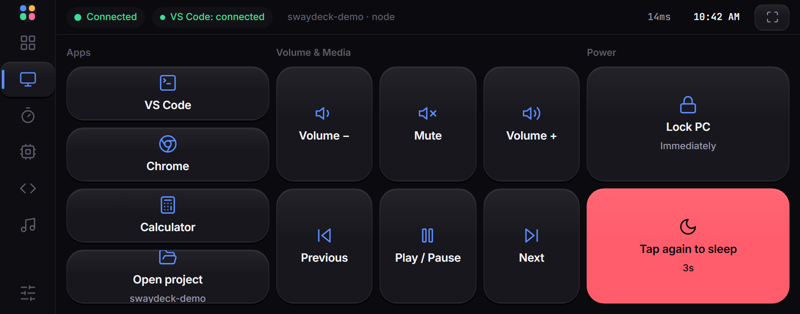
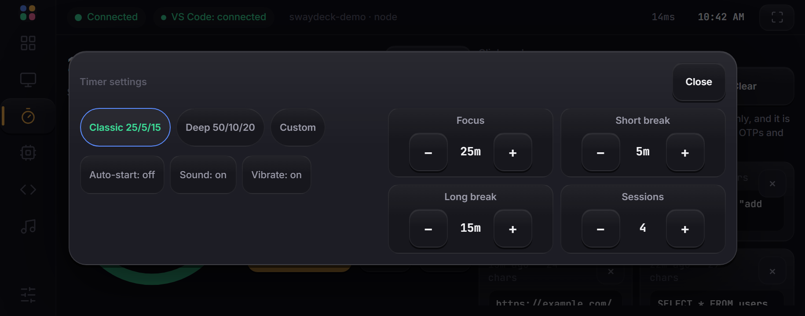
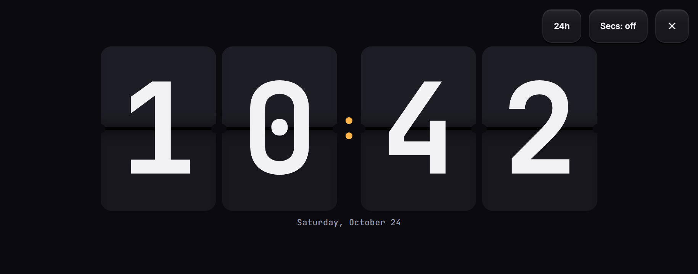
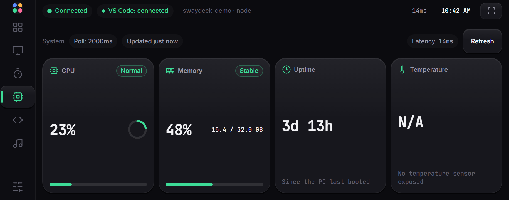
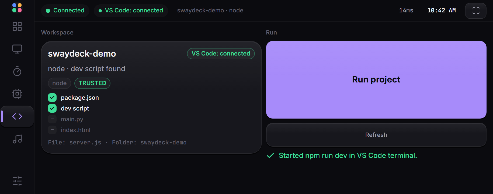
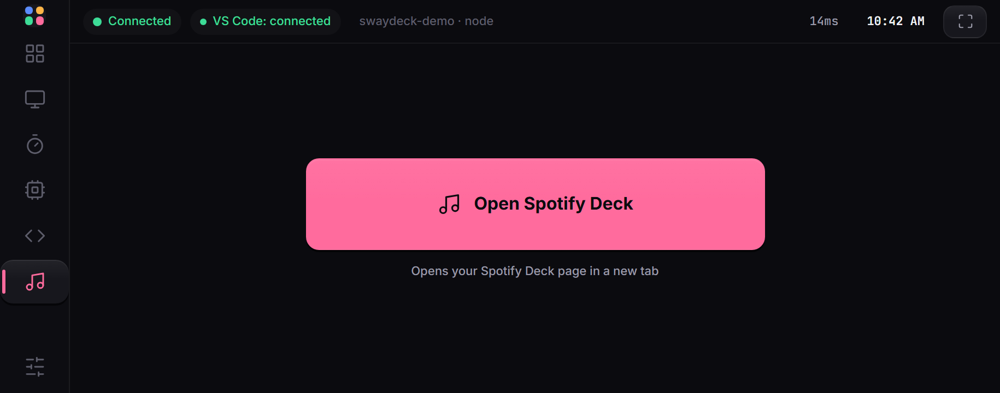

# SwayDeck

SwayDeck turns your Android phone into a fullscreen, landscape control deck for
your Windows PC. The phone talks to a small **SwayDeck agent** running on the PC
over a USB tunnel (`adb reverse`) — there is no Wi-Fi pairing, no cloud account
and no data leaving your machine. A second piece, the **SwayDeck Bridge** VS Code
extension, lets the deck see which project is open in VS Code and start it from
the phone.

The repository has two parts:

- `swaydeck-agent/` — the Node.js PC agent (serves the phone UI, runs PC actions, reads system stats, holds clipboard snippets).
- `swaydeck-vscode/` — the VS Code extension published to the Marketplace as **SwayDeck Bridge**.

## Features

- **PC control** — open Calculator / Chrome / VS Code, open the current project in
  VS Code, volume up / down / mute, media play-pause / next / previous, lock the
  PC and put it to sleep.
- **Smart Desk** — Pomodoro timer (with session counter and settings), a
  full-screen flip clock, and clipboard snippets you grab from the PC (opt-in,
  in-memory only).
- **System monitor** — CPU load, memory usage, uptime and CPU temperature
  (temperature is `N/A` on machines without a readable sensor).
- **Project** — see the detected VS Code workspace (project type, trust state,
  active file) and run the project from the phone.
- **Music** — a shortcut to launch the Spotify Deck web app on the phone.
- **Fullscreen landscape install** — the phone UI is a PWA (`display: fullscreen`,
  `orientation: landscape`) and pins to your home screen as a standalone app.

## Architecture

```
   PHONE (Chrome)              PC  (Windows)
  ┌──────────────┐          ┌───────────────────────┐          ┌────────────────────┐
  │  SwayDeck    │   USB    │   SwayDeck agent      │  ws://   │  VS Code           │
  │  web app     │ adb rev. │   Node.js + Express   │ 127.0.0 │  SwayDeck Bridge   │
  │  /ws  ───────┼─────────►│   127.0.0.1:3000      │◄────────►│  extension (/ext)  │
  │  (token auth)│ :3000    │   fixed action list   │  :3000   │  detect + run      │
  └──────────────┘          └───────────────────────┘          └────────────────────┘
        ▲                              │
        │  serves public/ (UI, PWA)    └── reads PC stats, clipboard snippets
        └──────────────────────────────
```

- The phone connects to `ws://localhost:3000/ws` (through the USB tunnel) and
  authenticates with the shared token.
- The extension connects to `ws://127.0.0.1:3000/ext` and only talks to this
  local agent.
- Everything binds to `127.0.0.1`; nothing is exposed to the LAN.

## Requirements

- **Windows 10 or 11** (the agent's PC actions are Windows-only).
- **Node.js 18 LTS or newer** (`engines.node` is `>=18.0.0`).
- An **Android phone with Chrome** and **USB debugging** enabled.
- **Android platform-tools (`adb`)** on your PATH —
  <https://developer.android.com/tools/releases/platform-tools>
- **VS Code** (only if you want the Project screen / running projects from the phone).

## Quick start

The short version. Each step is explained in detail further down.

1. **Start the agent** (terminal 1, keep it open):

   ```powershell
   cd swaydeck-agent
   npm install
   npm start
   ```

2. **Pair the phone** (terminal 2, phone plugged in with USB debugging on):

   ```powershell
   cd swaydeck-agent
   npm run pair
   ```

   The phone opens SwayDeck and the header shows **Connected**.

3. **Install the VS Code extension** (optional, for the Project screen): install
   **SwayDeck Bridge** from the Marketplace.
4. **Give the extension the token**: copy it with the command below, then in VS
   Code press `Ctrl+Shift+P`, run **SwayDeck: Set Pairing Token**, and paste.

   ```powershell
   # from swaydeck-agent/
   powershell -NoProfile -Command "Get-Content .swaydeck-token | Set-Clipboard"
   ```

5. Open the **Project** screen on the phone. When it says **VS Code: connected**,
   you are done.

## Install and run the agent

```powershell
cd swaydeck-agent
npm install
npm start
```

On startup the agent listens on `127.0.0.1:3000` and prints the pairing command
with your token:

```
SwayDeck running at http://127.0.0.1:3000

To pair your phone, run this (keep the token private):
adb shell am start -a android.intent.action.VIEW -d "http://localhost:3000/#t=<TOKEN>"
```

Keep this terminal open while you use SwayDeck. Closing it stops the agent, and
the phone shows **Offline**.

The token is generated once and stored in `swaydeck-agent/.swaydeck-token`
(git-ignored, never committed).

## The pairing token

### What it is

The pairing token is a long random secret that the agent creates the first time
it starts and saves in `swaydeck-agent/.swaydeck-token`. The agent only talks to
clients that present this exact token. Without it, a connection is rejected (the
agent log shows `rejected unauthenticated client`). This keeps other apps and web
pages on your PC or phone from controlling your computer.

Two things need the token:

| Who | How it gets the token | What you do |
| --- | --- | --- |
| **Phone** (SwayDeck web app) | From the pairing link (`...#t=<TOKEN>`). The page saves it in the phone browser's storage and removes it from the address bar. | Run `npm run pair`. You never type the token. |
| **VS Code extension** | You paste it once. | Run **SwayDeck: Set Pairing Token** in VS Code and paste the token. |

### How to get the token

Run these from the `swaydeck-agent/` folder.

- **Copy it to the clipboard without showing it on screen** (works in cmd and
  PowerShell):

  ```powershell
  powershell -NoProfile -Command "Get-Content .swaydeck-token | Set-Clipboard"
  ```

- **Show it in the terminal:**

  ```powershell
  type .swaydeck-token
  ```

- Or open the file in Notepad: `notepad .swaydeck-token`.
- Or copy it from the pairing command that `npm start` prints (it is the part after `#t=`).

When you paste it, make sure there are no spaces or line breaks before or after it.

### Keep it private

- Never commit `.swaydeck-token`, paste it in issues or chats, or show it in
  screenshots. Anyone who has the token and can reach the agent can control the
  actions it offers.
- The pairing command contains the token, so it also ends up in your terminal
  history. Clear it if you share your screen or machine.

### Resetting the token

If the token leaked, or you just want a new one:

1. Stop the agent (`Ctrl+C` in its terminal).
2. Delete `swaydeck-agent/.swaydeck-token`.
3. Start the agent again (`npm start`). It creates a new token. The old token stops
   working immediately.
4. Pair the phone again (`npm run pair`) and run **SwayDeck: Set Pairing Token**
   again in VS Code with the new token.

### When you need to pair again

- You reset the token (above), or deleted `.swaydeck-token`.
- You cleared the phone browser's site data for `localhost`, or switched to a new phone.
- The phone says **Not paired**, or the agent log says `rejected unauthenticated client`.

You do **not** need to pair again after a normal restart of the agent, replugging
the cable (just re-run `npm run pair` to reopen the USB tunnel), or restarting VS Code.

## Pair the phone

You need the agent running (`npm start`, terminal 1) and the phone plugged in with
USB debugging on. Run the commands below in a **second terminal**.

### Option A: one command (recommended)

```powershell
cd swaydeck-agent
npm run pair
```

This opens the USB tunnel (`adb reverse tcp:3000 tcp:3000`) and opens the pairing
link, with the current token in it, on the phone. The phone stores the token from
the URL and strips it from the address bar. SwayDeck opens and the header shows
**Connected**.

If it says adb was not found, install Android platform-tools and add it to your
PATH (see Requirements).

### Option B: manual steps

1. On the phone, enable **Developer options → USB debugging** and plug it into the PC.
2. Confirm the PC can see the phone:

   ```powershell
   adb devices
   ```

3. Open the USB tunnel so the phone's `localhost:3000` is the PC's agent:

   ```powershell
   adb reverse tcp:3000 tcp:3000
   ```

4. Open the pairing link on the phone, using the token from
   `swaydeck-agent/.swaydeck-token`:

   ```powershell
   adb shell am start -a android.intent.action.VIEW -d "http://localhost:3000/#t=<TOKEN>"
   ```

### If the link opens in a different browser

The pairing link opens in the phone's default browser. SwayDeck is built for
Chrome, so set **Chrome** as the default browser, then run `npm run pair` again.
The token is stored in the browser that opened the link, so pair in the same
browser you will use (and install the app from).

## Install the extension

Install from the [VS Code Marketplace](https://marketplace.visualstudio.com/items?itemName=SwayamSujjalMohanta.swaydeck-bridge).

### Connect the extension to the agent

The extension needs the same token as the phone. You do this once:

1. Copy the token (see [How to get the token](#how-to-get-the-token)).
2. In VS Code press `Ctrl+Shift+P` (Command Palette).
3. Run **SwayDeck: Set Pairing Token**.
4. Paste the token and press Enter.

With the agent running, the extension connects to `ws://127.0.0.1:3000/ext`. To
check, open the **Project** screen on the phone. The chip shows **VS Code:
connected** and the detected project appears.

Only one VS Code window controls the deck at a time. If you open a second window,
the older one shows `SwayDeck: Standby` until you focus it again (see
Troubleshooting).

## Install as a fullscreen app

1. Pair once (above) so Chrome has stored the token.
2. In Chrome on the phone, open the Chrome menu → **Add to Home screen** /
   **Install app**.
3. Launch it from the home screen. The installed app runs fullscreen in landscape
   (from `manifest.webmanifest`: `display: fullscreen`, `orientation: landscape`).

The USB tunnel must be open for the installed app to connect, so plug the phone in
and run `npm run pair` (or `adb reverse tcp:3000 tcp:3000`) first. If the installed
app says **Not paired**, open the pairing link in Chrome again with `npm run pair`.

## Usage per screen

- **Home** — hub with tiles for every screen plus overall connection status.
- **PC Control** — app launchers, volume/media keys, and power (lock / sleep).
  Sleep asks for a confirmation tap before it fires.
- **Smart Desk** — Pomodoro (start / reset / skip, session counter, settings) and
  the flip clock on the left, clipboard snippets on the right. Clipboard sync is
  **off by default**; only text you explicitly "Grab PC" is stored, in memory only.
- **System** — CPU, memory, uptime and temperature, polled while the screen is
  visible.
- **Project** — shows whether VS Code is connected, the detected project type and
  trust state, the active file, and a **Run project** button (with a **Refresh**
  button to re-ask the extension).
- **Music** — opens the Spotify Deck web app in a new tab on the phone.

## Security model

SwayDeck is built to stay on your machine:

- **Local-only listener.** The agent binds `HOST = "127.0.0.1"` (port 3000). It is
  never reachable from the LAN; the phone only reaches it through the USB tunnel.
- **Shared-token pairing with lockout.** The phone and the extension must send the
  shared token (Bearer header for `/api/status`, `auth` message for WebSocket).
  Comparison is timing-safe. After **5 failed attempts within 60 seconds**, further
  attempts are refused until the window clears (the socket is closed with code
  `4002`). The token is stored in `swaydeck-agent/.swaydeck-token`.
- **Fixed action allowlist, no shell strings from the phone.** The phone can only
  request actions that already exist in `actions.js`. Actions either spawn a fixed
  executable from a known path (`shell: false`) or run one fixed PowerShell snippet
  with integer key codes. No phone-supplied text is ever placed into a command, and
  nothing is run through a shell.
- **WebSocket origin checks.** `/ws` only accepts browser connections from
  `http://localhost:3000` / `http://127.0.0.1:3000`; `/ext` only accepts
  non-browser clients (no `Origin` header), so a web page cannot impersonate the
  extension.
- **Clipboard is opt-in and in-memory.** Sync is off by default. Only the text you
  explicitly grab is kept, only in memory (gone on restart, capped at 20 items /
  2000 chars), and likely secrets are skipped (private keys, JWTs, common API-key
  and token shapes, card numbers via Luhn, OTP/PIN-like strings, password-like
  strings). The text is never logged.
- **Nothing leaves the PC.** Neither the agent nor the extension makes outbound
  network calls or sends data anywhere. (The Music screen is a plain link the phone
  opens itself; it sends no data from the PC.)
- **Extension stays local and conservative.** The extension only connects to a
  `ws://` URL whose host is exactly `127.0.0.1` or `localhost` (anything else is
  refused), and it only ever starts the project by sending the fixed literals
  `npm run dev` or `python main.py` in a terminal — and only in a **trusted**
  workspace. It never builds a command from agent messages, `package.json` contents
  or file names, and never runs `npm install` for you.

See [SECURITY.md](SECURITY.md) for the threat model and how to report issues.

## Limitations

- **Windows only.** PC actions rely on Windows executables and PowerShell.
- **USB only.** Pairing uses `adb reverse`; there is no Wi-Fi / LAN mode.
- **Sleep may hibernate.** `sleep_pc` uses `SetSuspendState`, which hibernates
  instead of sleeping when hibernation is enabled. Turn hibernation off with:

  ```powershell
  powercfg -h off
  ```

- **No volume level or now-playing info.** Volume (up/down/mute) and media
  (play/pause, next, previous) are sent as keyboard media keys; the deck cannot
  read the current volume level or track metadata.
- **Temperature may be unavailable.** Many desktops/laptops expose no readable
  sensor; the monitor then shows `N/A`.

## Troubleshooting

- **Agent log shows `rejected unauthenticated client`.** A client connected without
  the correct token. If it is the phone, run `npm run pair` again from
  `swaydeck-agent/` (with the agent running) so the phone gets the current token.
  If you deleted `.swaydeck-token` or started a different copy of the agent, the
  token changed, so both the phone and the extension need to be paired again. Make
  sure only one agent is running (check port 3000, see below).
- **"Not paired" / token mismatch / pairing failed.** The token in the phone's
  local storage must match `swaydeck-agent/.swaydeck-token`. Re-run `npm run pair`
  (or re-open the pairing URL), then in VS Code run **SwayDeck: Set Pairing Token**
  with the same token. After several wrong attempts the agent locks out for up to a
  minute — wait and try again. If it still fails, clear the phone browser's site
  data for `localhost` (Chrome → Settings → Site settings → All sites → `localhost`
  → Clear & reset) and pair again.
- **The phone shows "VS Code: not connected".** The extension is not connected to
  the agent. Check that the agent is running, that you ran **SwayDeck: Set Pairing
  Token** with the current token, and that the right VS Code window is focused (only
  one window is active at a time).
- **`adb devices` does not list the phone.** Use a data-capable cable, set the USB
  mode to File transfer, and accept the "Allow USB debugging" prompt on the phone.
- **Phone connects, then loses the agent after replugging the cable.** `adb reverse`
  is per-connection. Re-run `npm run pair` (or the `adb reverse` command) after every
  replug.
- **Port 3000 is busy.** Another process already listens on `127.0.0.1:3000`. Stop
  it (or find it with `netstat -ano | findstr :3000`) and start the agent again.
- **Extension says "Standby".** Only one VS Code window can control the deck. When a
  second window connects, the agent closes the older socket with close code `4003`
  and that window shows `SwayDeck: Standby`. Focus the window you want to use; it
  takes the socket over automatically.
- **Volume / media keys do nothing (Num Lock).** The media keys are sent as virtual
  keys; on some keyboards Num Lock interference can swallow them. Toggle Num Lock off
  and try again.
- **Temperature shows `N/A`.** No temperature sensor is readable on this machine;
  this is expected, not an error.

## Screenshots

Every image below is **generated from fake demo data** — no real PC, clipboard,
token or project is captured:

- the pairing token is a dummy value,
- the phone's WebSocket is **mocked** (the agent is not running and nothing is
  forwarded anywhere),
- the workspace is a fictional `swaydeck-demo` (node project, active file
  `server.js`),
- the clipboard holds four harmless snippets (`npm run dev`, a git command,
  `https://example.com/docs`, a SQL line),
- the stats are invented (CPU 23%, RAM 48%, uptime 3d 13h 30m, no temperature
  sensor, so the real `N/A` state shows).



| Home | PC control | Smart Desk |
| --- | --- | --- |
|  |  |  |

| Sleep confirmation | Timer settings | Flip clock |
| --- | --- | --- |
|  |  |  |

| System monitor | Project | Music |
| --- | --- | --- |
|  |  |  |

### Regenerating the screenshots

```powershell
# from the repository root (development only)
npm install
npx playwright install chromium   # first run only, ~150 MB
npm run screenshots
```

The first run needs `npx playwright install chromium` (about 150 MB — Playwright
is a **devDependency** of the repo root, it is not part of the agent or the
extension). [`scripts/screenshots.js`](scripts/screenshots.js) serves
`swaydeck-agent/public/` from a throwaway `127.0.0.1` static server, opens it in
headless Chromium at 915×412 @2x, mocks the `/ws` socket, and navigates by
clicking the real deck controls, so a successful run is also a smoke test. The
PNGs land in `docs/screenshots/`.

## Roadmap

- Optional LAN / Wi-Fi pairing as an alternative to USB.
- Reading the actual volume level and basic now-playing info.
- More PC actions and user-defined shortcuts.
- macOS / Linux support for the agent's PC actions.

## License

[MIT](LICENSE) © 2026 Swayam Sujjal
